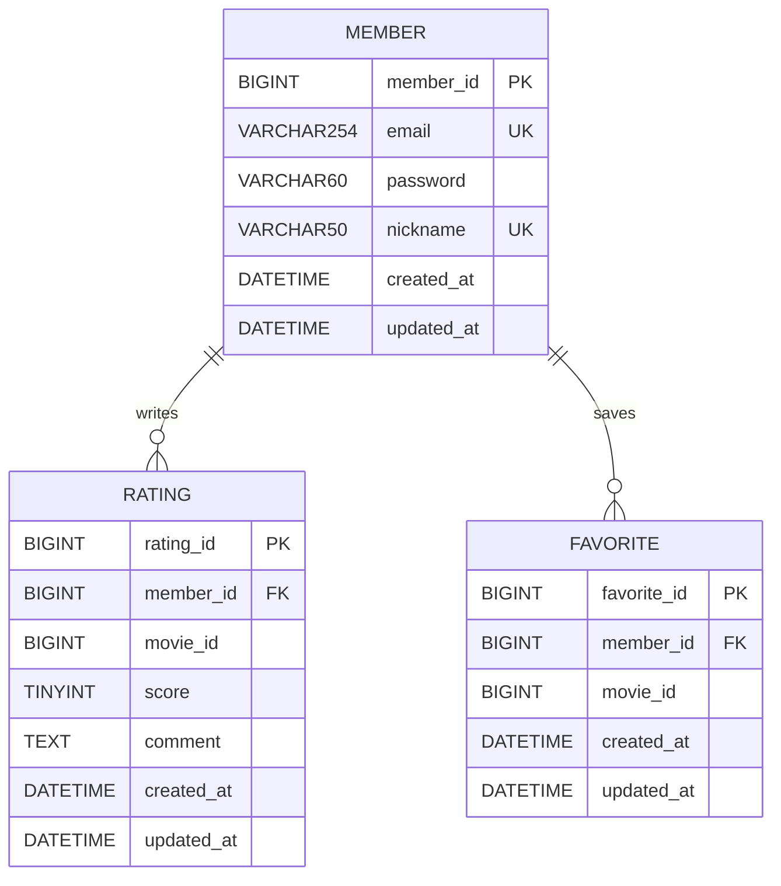

# 02. 요구사항과 ERD

회원은 이메일/닉네임을 중복 없이 갖는다. 회원 한 명은 여러 영화에 평점을 남기고 즐겨찾기할 수 있다. 한 회원은 같은 영화에 평점 하나, 즐겨찾기 하나만 등록한다. 영화 상세 정보는 TMDB에 있으므로 로컬 영화 테이블은 만들지 않는다.

- email/nickname은 각각 UNIQUE다.
- rating과 favorite은 각각 (member_id, movie_id)에 복합 UNIQUE 제약을 둔다.
- movie_id는 TMDB 식별자를 담는 일반 컬럼이다. 로컬 테이블을 참조하는 FK가 아니다.
- score의 목표 범위는 1~5다. 이번 워크북 SQL의 TINYINT 자체로 이 범위를 보장하지는 않는다. 이번 주 API는 조회만 제공하며 입력 검증은 다음 CRUD 단계에서 추가한다.
- password VARCHAR(60)은 워크북의 향후 bcrypt 사용을 위한 설계다. 시드는 로그인 불가능한 더미 값이다. 현재 인증 기능은 없다.
- favorite은 이번 주 DB 스키마만 준비한다. Java Entity/Repository/API 구현은 8주차 범위다.
- BaseTimeEntity는 @MappedSuperclass이므로 별도 테이블이 생기지 않는다. Hibernate를 통한 저장은 timestamp 어노테이션, 직접 SQL 저장은 DB 기본값이 시각을 채운다.
